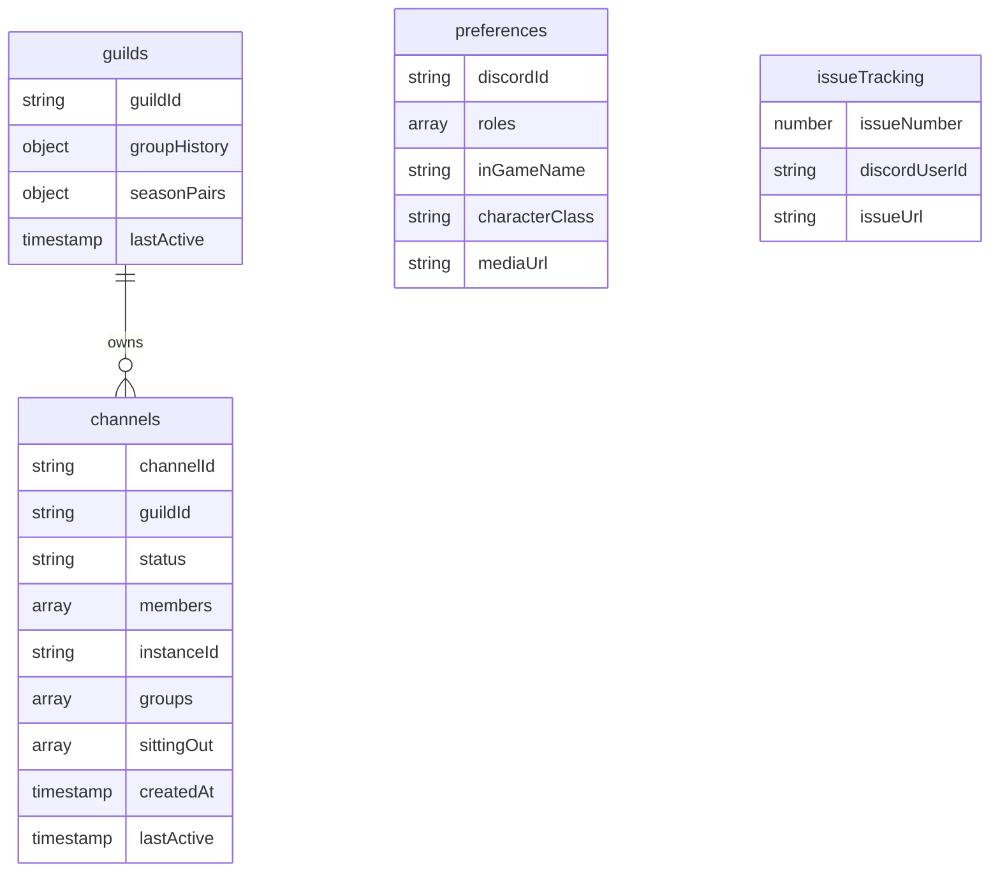
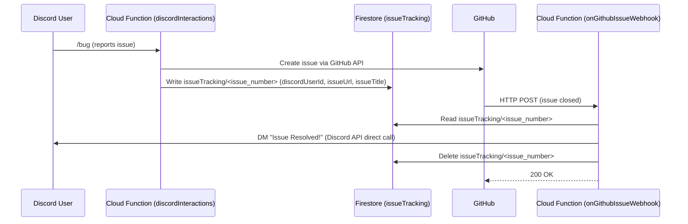
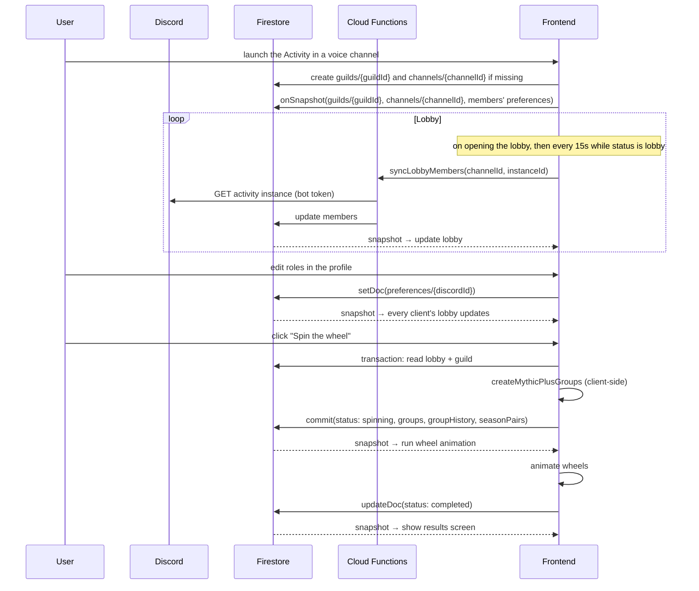
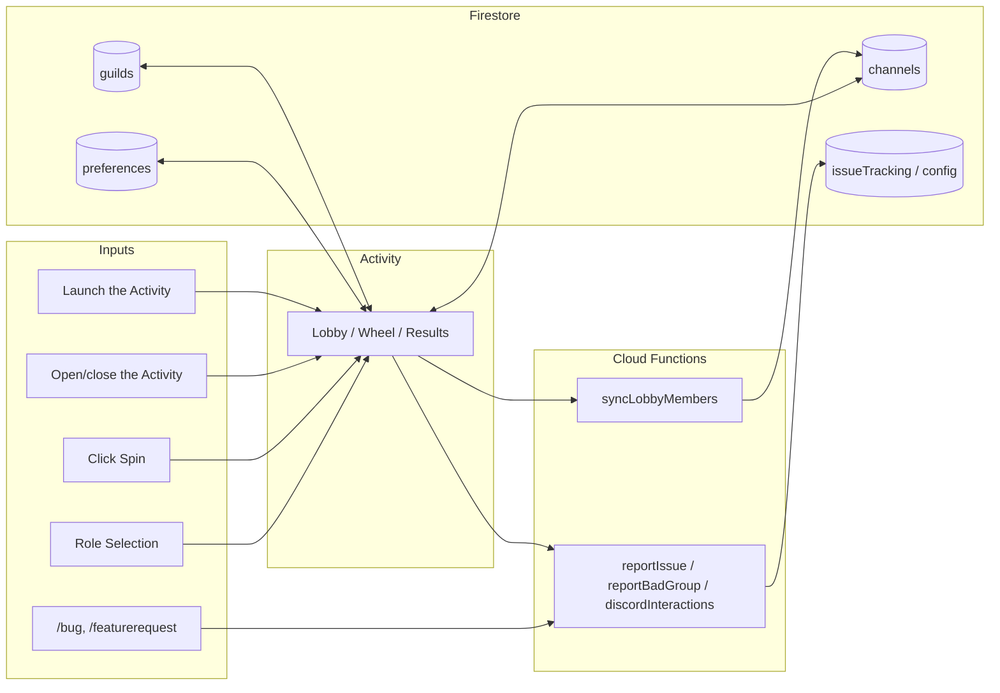

# Architecture Overview

This document gives a high-level picture of how **Firebase** (Firestore and Cloud Functions), the **Activity frontend** and **Discord** work together so you can quickly understand the system without diving into every file.

---

## What This System Does

**MythicPlusDiscordBot** (Wheelson) helps a WoW guild form Mythic+ groups. It:

1. Remembers who can tank, heal, or DPS in each player's profile (`preferences/{discordId}`), edited in the Activity.
2. Runs an **Activity**: a shared lobby + “wheel” experience backed by Firebase. Players launch the Wheelson activity in a voice channel; everyone who opens it there shares one lobby. When someone clicks “Spin,” the frontend computes groups and runs a wheel animation, then everyone sees the final groups.
3. Files bug reports and feature requests as GitHub issues, from the Activity or with `/bug` and `/featurerequest` in a server or a DM with Wheelson.

There is no server of our own. The Activity is a static site on GitHub Pages that reads and writes Firestore directly; Cloud Functions do the work that needs a secret (the bot token, the GitHub token, Battle.net) or must not be trusted to clients. Wheelson keeps a bot user in each server for the bot token, but nothing connects to Discord's gateway.

---

## High-Level Architecture

```mermaid
flowchart TB
    subgraph Discord["Discord"]
        User[Players in a voice channel]
        SDK[Embedded App SDK]
        API[Discord API]
    end

    subgraph Frontend["Activity (GitHub Pages)"]
        UI[Lobby, Wheel, Results]
        UI --> FirestoreClient[Firestore client SDK]
    end

    subgraph Firebase["Firebase"]
        Guilds[guilds/&#123;guildId&#125;]
        Channels[channels/&#123;channelId&#125;]
        Preferences[preferences/&#123;discordId&#125;]
        Sidecars[issueTracking, config]
        Functions[Cloud Functions]
    end

    User -->|launch the Activity| UI
    SDK -->|instanceId| UI
    FirestoreClient -->|read/write, onSnapshot| Guilds
    FirestoreClient -->|read/write, onSnapshot| Channels
    FirestoreClient -->|read/write, onSnapshot| Preferences
    UI -->|callables| Functions
    User -->|/bug, /featurerequest| API
    API -->|HTTP interactions| Functions
    Functions -->|bot token| API
    Functions -->|members| Channels
    Functions -->|write| Sidecars
```

- **Discord**: hosts the Activity in a voice channel and tells it who has it open. Slash commands arrive at the `discordInteractions` Cloud Function as HTTP interactions.
- **Activity frontend**: a web app that subscribes to one guild + channel document pair plus the members' preferences docs, and drives the lobby → wheel → results flow. It computes groups itself.
- **Firestore**: shared real-time state. Per-guild docs (`guilds/`) hold group history and season pair counts; per-channel docs (`channels/`) hold the live lobby (`members`, status, groups). `preferences/` holds each player's profile (roles, character) and is its single source of truth. Sidecar collections (`issueTracking`, `config`) handle GitHub issue tracking and shared config (affixes, season).
- **Cloud Functions**: the lobby roster (`syncLobbyMembers`), reports and slash commands, Discord sign-in, Battle.net lookups and the weekly data syncs.

---

## Main Components

### 1. Shared code (`packages/shared/src/`)

- **parallelGroupCreator**, **models**: the group algorithm and the `WoWPlayer` / `WoWGroup` models.
- **profiles**: the `LobbyMember` / `PlayerPreferences` wire shapes and their parsers, and `lobbyMemberName`. `WoWPlayer.fromPreferences(member, prefs)` is the one factory that joins them.
- Wire codecs for group history and season pairs, `todayPST`, and `obfuscatePii` for public issues.

### 2. Data Persistence

Firestore is the only store. Per-channel `channels/` docs are ephemeral (deleted by a Firestore TTL policy 24h after their roster was last synced); per-guild `guilds/` docs and `preferences/` docs persist.

### 3. Firebase (Firestore)

- **Role**: Real-time sync between Activity clients and Cloud Functions, plus durable preference and metadata storage.
- **Data**: Several top-level collections — see the layout below.

**Collection layout:**

| Collection         | Doc ID            | Owner / Notes |
|--------------------|-------------------|---------------|
| `guilds`           | `{guildId}`       | Per-guild state: `groupHistory`, `seasonPairs`. Older docs may still hold `guildName`, `guildIconUrl` and `voiceChannels` from the retired bot. |
| `channels`         | `{channelId}`     | Per-voice-channel lobby: `members` and `instanceId` (`syncLobbyMembers` only), `status`, `groups`, `sittingOut`, `guildId` back-reference. Deleted by the `expireAt` TTL policy when abandoned. |
| `preferences`      | `{discordId}`     | Each player's profile: roles, in-game name, linked character, character class, and media URL. The single source of truth for profiles; written by the Activity and the weekly `refreshCharacterMedia` function. |
| `issueTracking`    | `{issueNumber}`   | `reportIssue` (activity reports) and `discordInteractions` (`/bug`, `/featurerequest`) write a tracking doc per issue so the GitHub close webhook can DM the reporter. |
| `config`           | `affixes`, `season` | Read-only at runtime; populated by Cloud Functions. |
| `rateLimits`       | `{uid}_{endpoint}` | Per-user callable rate-limit windows; Cloud Functions only. Expired by TTL. |
| `characterCache`   | `{region}:{realm}:{name}` | Battle.net lookup cache; Cloud Functions only. Expired by TTL 30 days after its last refresh. |

**`channels/{channelId}` document shape:**

| Field       | Type      | Description |
|------------|-----------|-------------|
| `channelId`| string    | Discord voice channel ID (also the doc ID) |
| `guildId`  | string    | Back-reference to the parent guild doc |
| `channelName` | string | Voice channel display name |
| `status`   | string    | `lobby` → `spinning` → `completed` |
| `members`  | array     | `{ discordId, name }` for everyone with the activity open (name from `lobbyMemberName`: server nickname, display name or username, dots stripped). Written only by `syncLobbyMembers`; clients join it with `preferences` |
| `instanceId` | string  | The Discord activity instance `members` came from. Written only by `syncLobbyMembers`, which clears the round when it changes |
| `groups`   | array     | Computed groups (tank, healer, dps); filled by the frontend on transition to `spinning` |
| `revealedGroups` | number | How many groups are revealed; set with `revealStartAt` when someone presses Spin on the wheels screen |
| `revealStartAt` | timestamp | Server time Spin was pressed. Every client plays the reveal from it (`activity/src/lib/revealTimeline.ts`), so all screens animate together |
| `sittingOut` | array   | IDs of players sitting out the current round |
| `isDebug`  | boolean   | Left from the retired bot's `/test` lobbies; always false now |
| `createdAt`| timestamp | When the lobby was created |
| `lastActive`| timestamp | Updated on lobby creation and on every `syncLobbyMembers` write |
| `expireAt` | timestamp | Server-only. 24h after the latest roster sync (pushed out while the activity stays open); the TTL policy in `firestore.indexes.json` deletes the lobby once it passes |

- **Cloud Functions**: `syncLobbyMembers` writes `members`, `instanceId` and `expireAt`; nothing server-side acts on a round's status.
- **Frontend**: subscribes with `onSnapshot` to a `guilds/{guildId}` doc and a `channels/{channelId}` doc (using the `guildId` and `channelId` the Discord SDK launched it with), plus the `preferences` docs of the lobby members and the current user (one listener per doc, so a player joining or leaving adds or drops just their listener). The store joins them into the `players` roster every view reads. Profile edits write only `preferences`; every client's roster follows. When the user clicks Spin it runs `createMythicPlusGroups` client-side and writes the computed `groups` plus `status: spinning` in a transaction, then writes `status: completed` after the animation finishes. No server computes groups.

Security rules and cleanup are described in `FIREBASE_SETUP.md` and the canonical `firestore.rules` at the repo root.

### 4. Activity Frontend (TypeScript / Vite)

- **Role**: Provides the lobby and “wheel” experience for an Activity session. It is a static app that reads and writes Firestore and calls a few Cloud Functions.
- **Entry**: `activity/src/main.tsx`. Real lobbies only open inside the Discord Activity: on load it takes `guildId` and `channelId` from the Discord SDK and shows the connecting screen (`activity/src/views/ConnectingView.tsx`), which opens that voice channel's lobby. Opened in a browser, the app shows the home screen, which points to Discord and offers the demo. The one exception is the smoke test, whose `?guildId=&channelId=` link is honored only in a build pointed at the Firestore emulator (`VITE_FIRESTORE_EMULATOR_HOST`).
- **Firebase**: Uses the Firebase JS SDK (see `activity/src/firebase.ts`) with config from `VITE_FIREBASE_*` env vars. It signs in anonymously so `firestore.rules` can check its writes.
- **Identity**: By default the activity works out who the user is: the Discord ID remembered in localStorage, then the "Select Your Name" picker. (The SDK's participant list can't help: Discord refuses it to an activity that hasn't authenticated.) Inside the Discord activity the user can opt in to **Sign in with Discord** (identity picker or profile modal; `activity/src/services/discordAuth.ts`). The Embedded App SDK's `authorize` returns an OAuth2 code (Discord shows its one-click consent modal the first time), the `discordSignIn` Cloud Function verifies it and returns a Firebase custom token whose uid is the Discord ID, and the activity signs in with it. That ID (`verifiedDiscordId` in the store) overrides every guess, and Firebase Auth keeps the session, so later launches restore it without asking. `firestore.rules` treat both kinds of user the same.
- **Flow**:
  1. Subscribe to `guilds/{guildId}`, `channels/{channelId}` and the members' `preferences` docs with `onSnapshot`. The connecting screen opens the launch channel's lobby if there isn't one yet; an existing lobby is joined as it is, so a round in progress keeps going for everyone.
  2. **Lobby**: Always render the joined roster (`members` + `preferences`); show/hide lobby vs wheel vs results based on `status`. `useLobbySync` (`activity/src/hooks/useLobbySync.ts`) keeps `members` to the people with the activity open: each client calls `syncLobbyMembers` when it opens the lobby and every 15 seconds while the status is `lobby`, and the function, which reads the instance's users from Discord, writes only on a change. The client can't follow joins and leaves itself: Discord refuses the SDK's participant calls (`getInstanceConnectedParticipants`, `ACTIVITY_INSTANCE_PARTICIPANTS_UPDATE`) to an activity that hasn't run `authenticate`, and players sign in anonymously.
  - **Profile**: the header avatar and profile modal read the current user's `preferences` doc (their Discord ID is remembered in localStorage between visits; nothing else is). Without a known ID, the modal asks the user to pick themselves in a lobby first.
  - **Connections**: "View Connections" in the profile modal opens a per-player overlay of the guild's season pairings. It isn't part of the status-driven navigation, so it moves no one else, and the round keeps going underneath.
  3. **Spin**: User clicks “Spin” → one transaction (`startSpin` in `activity/src/services/lobby.ts`) reads the lobby and guild docs, runs `createMythicPlusGroups` client-side, and writes `groups` + `status: 'spinning'` to the lobby together with the guild's `groupHistory` and `seasonPairs` (each pair's count is incremented; the whole map is replaced when `config/season` changes). No client shows the round until the server accepts it, so a second Spin click can't put different groups on one screen.
  - **Connection**: the SDK reconnects its listeners by itself. The `config/season` listener's `fromCache` flag (every client follows it and none writes it) drives the "Reconnecting…" status.
  4. **Spinning**: Pressing Spin on the wheels screen writes `revealedGroups` and `revealStartAt` (server time) in one transaction (`startReveal` in `activity/src/services/lobby.ts`). Every client then plays the reveal in `activity/src/views/WheelsView.tsx` from that start time plus a short lead, waiting until each step's time on the timeline (`activity/src/lib/revealTimeline.ts`) rather than for fixed delays. Screens stay together, one that falls behind catches up, and one that joins mid-reveal skips what it missed. Each client then writes `status: 'completed'`.
  5. **Completed**: Show final groups; if the channel doc is deleted (its TTL expired), show “Activity ended.”

So the frontend is a **state machine** driven by the guild + channel documents in Firestore.

#### Frontend Modes
The Activity frontend (`activity/src/main.tsx`) operates in three distinct modes to support production, demos, and testing:

1.  **Firebase Mode (Production):**
    -   Triggered when launched as a Discord Activity (the smoke test also uses it, with a `?guildId=&channelId=` link against the emulators).
    -   Connects to live Firestore and Cloud Functions.
2.  **Demo Mode (Standalone):**
    -   Triggered by clicking "Start Demo" on the home screen, the page a browser shows outside Discord.
    -   Uses `mockSession` data purely in-memory. Allows users to "test drive" the UI outside Discord.
3.  **Mock/Static Mode (Testing):**
    -   Triggered by injecting a base64-encoded JSON object via the `?data=...` query parameter.
    -   Used by **automated tests** (Playwright) to force the UI into specific states (e.g., displaying results) without needing a backend.

---

### 5. Firebase Cloud Functions (v2)

- **Role**: Everything server-side: the lobby roster, reports and slash commands, external integrations, background syncs, and rate limiting.
- **Entry**: `packages/functions/src/index.ts`. Deployed to Firebase natively using Firebase Functions v2.
- **Key Functions**:
  - `fetchWeeklyAffixes` (`fetchWeeklyAffixes.ts`): Scheduled function (`onSchedule`) that fires weekly on Tuesdays to pull current Mythic+ affix data from the **Raider.IO API** and sync it to the `config/affixes` and `config/season` Firestore documents.
  - `lookupCharacter` (`lookupCharacter.ts`): Callable function (`onCall`) that securely bridges the Activity frontend to the **Battle.net API**, enforcing rate limits and caching results in Firestore (`characterCache/` collection, expired by TTL). It answers `not-found` only when Battle.net has no such character (a 404); a rate limit or outage is `unavailable`, which the Activity shows as a retryable failure rather than a bad name.
  - `discordSignIn` (`discordSignIn.ts`): Callable function (`onCall`) behind the activity's optional Discord sign-in. Exchanges the OAuth2 code from the Embedded App SDK's `authorize` for an access token, reads the user's Discord ID, and returns a Firebase custom token for that ID. The access token never leaves the function.
  - `refreshCharacterMedia` (`refreshCharacterMedia.ts`): Scheduled function (`onSchedule`) that fires weekly on Tuesdays to bulk-refresh character portrait and class data for all users in the `preferences/` collection. A Battle.net failure skips that player for the week; only a 404 for a typed name clears the character fields.
  - `reportIssue` (`reportIssue.ts`): Callable function behind the activity's "Report a bug or request a feature" (profile modal). Only players signed in with Discord can call it (`discordIdFromAuth` in `auth.ts`), so the reporter is known: it opens the GitHub issue, writes `issueTracking`, and DMs the reporter the link.
  - `reportBadGroup` (`reportBadGroup.ts`): Callable function behind "Report bad group" on the results screen, open to every player. It reads the lobby's groups and the guild's earlier rounds from Firestore itself, so the issue shows exactly what the algorithm produced. Issue bodies are built and cleaned (`obfuscatePii` from `@mythicplus/shared`, broken-up `@` mentions) in `issueReports.ts`.
  - `discordInteractions` (`discordInteractions.ts`): Wheelson's HTTP interactions endpoint, for `/bug` and `/featurerequest` in servers and in DMs with Wheelson (`reportCommands.ts`), plus the activity's Entry Point command. It checks Discord's Ed25519 signature with the application's public key (read with the bot token), opens the report form or files the issue within Discord's 3-second deadline, and writes `issueTracking`. Discord sends interactions here because the Developer Portal's Interactions Endpoint URL points at it (DEPLOYMENT.md section 3.1). The deploy registers the commands (`applicationCommands.ts`, run by `scripts/registerCommands.ts`).
  - `syncLobbyMembers` (`syncLobbyMembers.ts`): Callable function that writes a lobby's `members`. The client names its channel and the Embedded App SDK's `instanceId`; the function reads that activity instance from Discord (`GET /applications/{app}/activity-instances/{id}` with the bot token), refuses one that isn't running in the channel's server and channel, and writes the instance's users, naming newcomers from the server's member list. It writes only when something changed (`lobbySync.ts`), and a new instance clears the last session's round.
  - `onGithubIssueWebhook` (`githubWebhook.ts`): An HTTP (`onRequest`) webhook that receives GitHub issue closed events and notifies the reporting Discord user directly.
- **Manual runs**: There are no callable "refresh now" functions. To run a scheduled function on demand, use **Force run** on its job in Cloud Scheduler (Google Cloud console).
- **Secrets**: Credentials live in Google Secret Manager and are read with `defineSecret` from `firebase-functions/params`. Each function lists the secrets it uses in its `secrets` option (`battleNetSecrets` from `battlenet.ts` for the Battle.net callers). See `FIREBASE_SETUP.md` section 7.
- **Build and deploy**: `npm -w packages/functions run build` bundles `src/` with esbuild (`build.mjs`) into `dist/index.js`, inlining `@mythicplus/shared`; `firebase-admin` and `firebase-functions` stay external runtime dependencies. `tsc` is typecheck-only. The `deploy-firebase` job in `deploy.yml` builds the bundle, strips `devDependencies` from `package.json` (Cloud Build runs a lockfile-less `npm install`, and the workspace-only `@mythicplus/shared` isn't on npm), then runs `firebase deploy`.

#### Webhook Notification Flow

When a user reports a bug from the activity (`reportIssue`) or with `/bug` (`discordInteractions`), a tracking document is written to Firestore. When GitHub closes the issue, the Cloud Function is called, looks up the tracking document, sends a Discord DM directly, and deletes the document — all synchronously within the HTTP request.

## How an Activity Run Works (End-to-End)

This is the sequence from “someone launches the Activity” to “everyone sees groups.”

- **Creation**: The Activity creates the guild + channel docs when they don't exist yet.
- **Lobby**: `syncLobbyMembers` keeps `members` on the channel doc to the people with the Activity open; the frontend joins them with `preferences` and renders.
- **Spin**: Frontend computes `groups` client-side and writes `spinning` + `groups` to the channel doc; frontend animates and writes `completed`; every client shows the results.

---

## Where Key Behaviors Live

| Concern | Where it lives |
|--------|-----------------|
| Slash commands (`/bug`, `/featurerequest`, Entry Point) | Definitions in `packages/functions/src/applicationCommands.ts` (registered by `deploy.yml`); handling in `discordInteractions.ts` → `reportCommands.ts` |
| Player profiles | Activity `RoleEditor` → `preferences/` (plus `usePortraitRepair`, which fills in the current user's missing portrait once per launch); the Activity joins them in `activity/src/lib/profiles.ts` and builds players with `WoWPlayer.fromPreferences` |
| GitHub Issues from the activity (bug reports, feature requests, bad-group reports) | `packages/functions/src/reportIssue.ts`, `reportBadGroup.ts`, `issueReports.ts` |
| GitHub Issues from `/bug`, `/featurerequest` | `packages/functions/src/discordInteractions.ts`, `reportCommands.ts`, `issueReports.ts` |
| Activity participants → lobby roster | `activity/src/hooks/useLobbySync.ts` → `packages/functions/src/syncLobbyMembers.ts` |
| Channel/guild doc create/listen/update | `activity/src/services/firestoreService.ts`, `activity/src/services/lobby.ts` |
| Group algorithm | `packages/shared/src/parallelGroupCreator.ts` |
| “Spin” handling | Frontend: `activity/src/services/lobby.ts` (`startSpin`, called by `requestSpin`) — runs the algorithm client-side and writes `spinning`+`groups`, history and season pairs in one transaction |
| Activity UI and wheel | `activity/src/main.tsx`, `activity/src/views/WheelsView.tsx` |
| Channel doc cleanup | The `channels.expireAt` TTL policy; a new activity instance clears the round (`lobbySyncUpdate` in `packages/functions/src/lobbySync.ts`) |

---

## Configuration That Ties Everything Together

- **Frontend ↔ Firebase**: `VITE_FIREBASE_*` (apiKey, authDomain, projectId, etc.) in the Activity build.
- **Frontend ↔ Discord**: `VITE_DISCORD_CLIENT_ID` (the application ID) for the Embedded App SDK, plus the Developer Portal's URL mappings (`ACTIVITY_SETUP.md`).
- **Cloud Functions**: secrets in Secret Manager (`BOT_TOKEN`, `DISCORD_APPLICATION_ID`, `GITHUB_ISSUES_TOKEN` and others; `FIREBASE_SETUP.md` section 7).
- **Deploy**: `FIREBASE_CREDENTIALS_JSON`, `BOT_TOKEN` and `DISCORD_APPLICATION_ID` from Doppler (`DEPLOYMENT.md`).

For step-by-step setup, see `DEPLOYMENT.md`, `ACTIVITY_SETUP.md` and `FIREBASE_SETUP.md`.

---

## Summary Diagram

- **Activity**: launched in a voice channel → subscribe to guild + channel docs and the members' preferences → keep the roster in step with who has the activity open → user clicks Spin → write status → read updates and drive UI.
- **Firestore**: shared real-time state plus durable `preferences/` and operational sidecars.
- **Preferences**: each player's profile lives only in `preferences/{discordId}`. The Activity writes it; every Activity client reads it.
- **Cloud Functions**: the roster, the reports (sent to GitHub), and the slash commands.

This should be enough to get a clear mental model of how Firebase, the Activity frontend and Discord work together. For implementation details, use this doc as a map and then open the referenced files.
