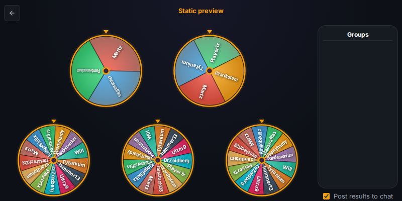

<div align="center">

# MythicPlusDiscordBot 💎

### [ 🚀 Launch App ](https://tytaniumdev.github.io/MythicPlusDiscordBot/)  |  [ 📖 Documentation ](#documentation-map)  |  [ 🐞 Report Bug ](https://github.com/tytaniumdev/MythicPlusDiscordBot/issues/new?template=bug_report.md)

<br/>

[](https://github.com/tytaniumdev/MythicPlusDiscordBot/actions)
[](LICENSE)

</div>

> **The "Front Door" for your guild's Mythic+ groups.**
> Organize and spin balanced Mythic+ groups together in a Discord Activity.

---

## 📸 Preview



## ⚡ Quick Start (Local Development)

Get up and running in less than 5 minutes.

1.  **Clone the repo**
    ```bash
    git clone https://github.com/TytaniumDev/MythicPlusDiscordBot.git
    cd MythicPlusDiscordBot
    ```

2.  **Install Dependencies**
    This project uses `npm` workspaces.
    ```bash
    npm ci
    ```

3.  **Run the activity**
    The demo runs in any browser with no setup:
    ```bash
    npm -w activity run dev
    ```
    Open the printed URL and click **Start Demo**. Real lobbies only open inside the Discord activity.

4.  **Verify your changes**
    ```bash
    ./scripts/verify-ts.sh
    ```

## ✨ Key Features

*   **Group Organization**: Automatically calculate balanced Mythic+ groups based on player roles and key levels.
*   **Discord Activity**: Interactive "Wheel of Fate" for selecting keys or players, launched from a Discord voice channel.
*   **GitHub Integration**: Report bugs and request features from the Activity, or with `/bug` and `/featurerequest` in a server or a DM with Wheelson.

## 🗺️ Documentation Map <a id="documentation-map"></a>

*   **🏗️ Architecture**: [Architecture Documentation](./ARCHITECTURE.md) - Understanding the core logic and services.
*   **🚀 Deployment**: [Deployment Guide](./DEPLOYMENT.md) - The deploy workflow, its secrets, and Discord setup.
*   **🎮 Activity Setup**: [Activity Configuration](./ACTIVITY_SETUP.md) - Configuring the Discord Activity and Frontend.
*   **🔥 Firebase Setup**: [Firebase Configuration](./FIREBASE_SETUP.md) - Database and Auth configuration.
*   **👨‍💻 Contributing**: [Development Standards](./CONTRIBUTING.md) - Development standards and guidelines.
*   **🛡️ CI Standards**: [CI & Security Standards](./docs/CI_STANDARDS.md) - CI and security standards.
*   **🤖 AI Agents**: [Agent Instructions](./AGENTS.md) - Instructions for AI coding agents (also loaded via `CLAUDE.md`).
*   **📜 Terms of Service**: [Terms of Service](./TERMS.md) - Rules for using Wheelson.
*   **🔒 Privacy Policy**: [Privacy Policy](./PRIVACY.md) - What data the app collects and how it is used.

## 🤝 Contributing

We welcome contributions! Please check the [Contributing Guidelines](./CONTRIBUTING.md) for development standards, guidelines, and verification instructions.

---

_Maintained by TytaniumDev_
